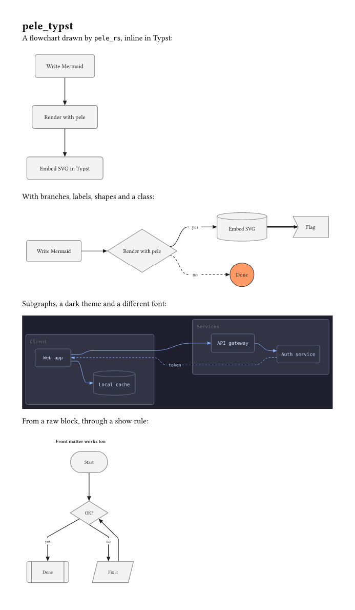

# pele_typst

Render [Mermaid](https://mermaid.js.org) diagrams in Typst with **pele_rs**, a Rust port of
[pele](https://github.com/obsidianmd/pele), the fast Mermaid renderer from Obsidian. The port is
compiled to a WebAssembly plugin, so it runs in the Typst CLI and the web app alike.

```typ
#import "@local/pele_typst:0.1.0": mermaid

#mermaid("
flowchart TD
  A[Write Mermaid] --> B[Render with pele]
  B --> C[Embed SVG in Typst]
")
```



**Status:** flowcharts (`flowchart` / `graph`) are ported, with every shape, subgraphs,
`classDef`/`style`/`linkStyle`, front matter and `%%{init}%%` config, and `@{ shape: … }`
metadata. pele's other diagram types (sequence, class, state, …) report
`Diagram type "…" is not supported yet.` For the ported types, `pele_rs` writes the same SVG as
pele's JavaScript byte for byte; see [Tests](#tests).

## Usage

```typ
#mermaid(
  source,                      // str, or a raw block
  width: auto, height: auto,   // image size; by default the diagram's natural size
  fit: "contain",
  font: auto,                  // label font; by default the surrounding text's
  font-size: auto,             // label size; by default the surrounding text's
  mono-font: "DejaVu Sans Mono",
  padding: 8pt,
  theme: (:),                  // pele's CSS variables by short name
  background: auto,            // paint theme.bg behind the diagram; on when theme.bg is set
  config: (:),                 // Mermaid config, e.g. (flowchart: (curve: "linear"))
  alt: none,
)
```

Render every `mermaid` raw block:

```typ
#show raw.where(lang: "mermaid"): it => mermaid(it, font: "Libertinus Serif")
```

Inside a raw block the text font is monospace, so pass the font you want.

Theme keys are pele's [CSS variables](https://pele.run/theming) without the `--pele-` prefix:
`bg`, `fg`, `muted`, `line`, `surface`, `surface-alt`, `border`, `accent`, `radius`,
`fg-on-light`, `fg-on-dark`, `critical`, and the `*-weight` keys. Values may be Typst colors,
lengths or strings:

```typ
#mermaid(theme: (bg: rgb("#1e1e2e"), fg: rgb("#cdd6f4"), line: rgb("#89b4fa"),
                 surface: rgb("#313244"), border: rgb("#6c7086"), radius: 6pt), "...")
```

Labels are measured with pele's table of Arial widths and drawn in the font you choose, so a
font much wider than Arial can overflow its boxes.

## Installing

Typst reads local packages from `{data-dir}/typst/packages/local/pele_typst/0.1.0`, where
`{data-dir}` is `~/Library/Application Support` on macOS, `~/.local/share` on Linux and
`%APPDATA%` on Windows. Link or copy this folder there; only `typst.toml`, `lib.typ`,
`pele_typst.wasm`, `README.md` and `LICENSE` are needed. For the web app, upload those files to
a project and use "File > Package project" (see
[private packages](https://typst.app/docs/web-app/private-packages/)).

## Building

`pele_typst.wasm` is built from the two Rust crates here:

- `pele_rs/`: the port of pele, a plain Rust library (`pele_rs::render(text, &options)`).
- `plugin/`: the Typst plugin. It renders with `pele_rs` and inlines pele's CSS custom
  properties, `color-mix()` and `calc()` into plain SVG attributes, which Typst's SVG renderer needs.

```sh
rustup target add wasm32-unknown-unknown
./build.sh
```

## Tests

`pele_rs/tests/fixtures.rs` renders each source in `pele_rs/tests/fixtures/flowchart.json` and
compares it with the SVG that pele's JavaScript gave: 188 flowcharts from pele's docs corpus,
its test files and extra cases here, all identical. Regenerate the fixtures from a pele checkout
with [bun](https://bun.sh):

```sh
cd pele_rs
bun scripts/harvest.ts ../../pele > scripts/harvested-flowcharts.json
bun scripts/fixtures.ts ../../pele
cargo test
```

Error positions are reported in the text after front matter and comments are removed, which can
differ from pele's line numbers, and YAML errors are worded differently.

## License

MIT. pele is MIT licensed by kepano; see [LICENSE](LICENSE).
